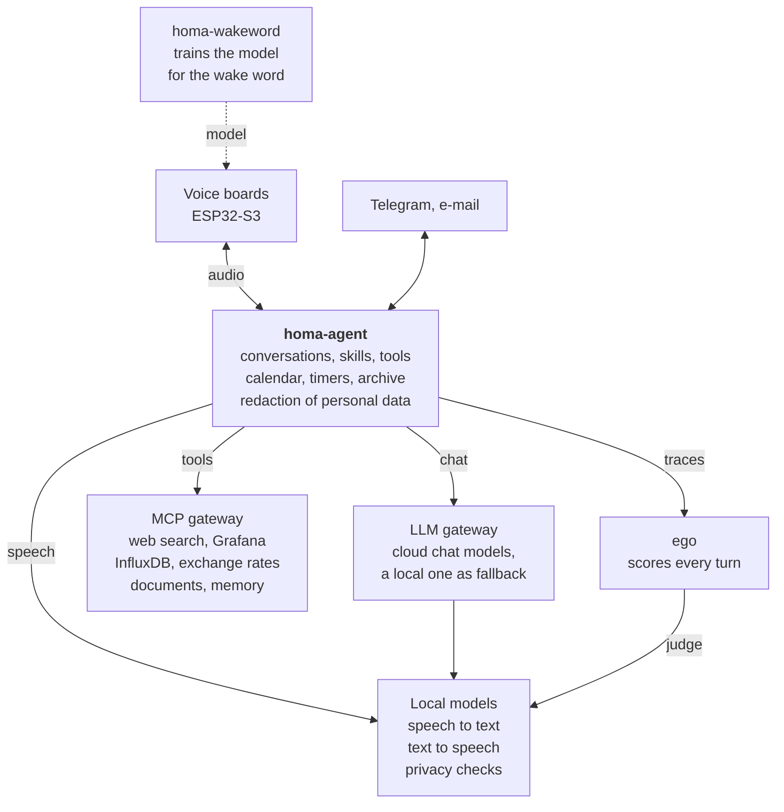

  

<h1 align="center">Homa</h1>

<b>H</b>ome <b>O</b>rchestration and <b>M</b>onitoring <b>A</b>ssistant

Homa is a self-hosted household assistant. You talk to it by voice through a
small ESP32 board or by text in Telegram, and it keeps the house's calendar,
reminders, messages and documents in order. It runs on hardware you own and
works with any OpenAI-compatible model, local or in the cloud.

The smallest setup is one Go server and a chat model. Everything else (voice
boards, Telegram, calendar, e-mail, web search, document reading, memory) is
optional and switches on with configuration.

## How it fits together

**A turn.** A person says the wake word or writes a message. A voice board
streams the audio to the agent, which has it transcribed, decides which skills
apply, calls the chat model and the tools it asks for, and answers: aloud on
the same board, or as text where the message came from. Each person has their
own conversation, calendar and reminders.

**Voice boards.** [homa-esp32](https://github.com/homa-platform/homa-esp32)
runs on ESP32-S3 boards with a screen, a microphone and a speaker. A small
model on the board listens for the name; everything after it goes to the
server over HTTP and a WebSocket. Firmware updates are signed and install only
after the owner approves them. The on-device model is trained with
[homa-wakeword](https://github.com/homa-platform/homa-wakeword), built on
[microWakeWord](https://github.com/OHF-Voice/micro-wake-word).

**Models.** The agent speaks the OpenAI API to one endpoint and needs nothing
else. Which models stand behind it is configuration:

| Job | In the reference deployment |
|---|---|
| Conversation | one model name on an LLM gateway ([agentgateway](https://github.com/agentgateway/agentgateway)) that fails over: Claude Sonnet, then DeepSeek, then a local Qwen |
| Speech to text | Whisper Large v3, local |
| Text to speech | a multi-speaker Ukrainian StyleTTS2, local |
| Wake word | microWakeWord on the board, then the transcript is checked on the server |
| Is this document private? What in it is personal? | a local Qwen, never a cloud model |
| Judging the agent's turns | a local Qwen, called by ego |

The local models are served by [Lemonade](https://github.com/lemonade-sdk/lemonade);
any OpenAI-compatible server does the same job. Speech and the household's
documents stay on local models even when the conversation runs in the cloud.

**Tools over MCP.** What is not built into the agent comes from
[MCP](https://modelcontextprotocol.io) servers behind one gateway, which gives
the agent its own route and an allow-list. A skill brings a tool into the
model's context only on the turns that need it.

| Tools | Server |
|---|---|
| Web search and page reading | [SearXNG](https://github.com/searxng/searxng) through [mcp-searxng](https://github.com/ihor-sokoliuk/mcp-searxng) |
| Dashboards, metrics and logs, read-only | [mcp-grafana](https://github.com/grafana/mcp-grafana) |
| Time series | influxdb-mcp |
| Exchange rates | fx-mcp |
| Documents: PDF, scans, office files | docs-mcp, on [Apache Tika](https://github.com/apache/tika) with OCR |
| Long-term memory | [X-Ray](https://github.com/triageagent-dev/x-ray) |

**Memory.** [X-Ray](https://github.com/triageagent-dev/x-ray) keeps what is worth remembering between conversations. The
agent recalls from it before a turn and writes to it through a skill; personal
identifiers are refused at the door.

**Evaluation.** Every turn leaves an OpenTelemetry trace.
[ego](https://github.com/triageagent-dev/ego) reads the traces and scores the
turns: was the answer backed by what the tools returned, were the right tools
used, was the request resolved. The judge is a local model, so conversations
are not sent anywhere to be graded.

**Privacy.** A document or a letter with personal data reaches a cloud model
only as a copy in which names, addresses, numbers and accounts are replaced
by placeholders; the values come back in the answer on the way to the person.

## Repositories

| Repository | What it is |
|---|---|
| [homa-agent](https://github.com/homa-platform/homa-agent) | The server: conversations, tools, skills, the voice pipeline, Telegram and e-mail channels, the redact service |
| [homa-esp32](https://github.com/homa-platform/homa-esp32) | Firmware for the voice boards: wake word, face, follow-up listening, signed updates |
| [homa-wakeword](https://github.com/homa-platform/homa-wakeword) | Training pipeline for the on-device wake-word model |
| docs-mcp | Reading PDFs, scans and photos for the agent *(coming)* |
| homa-adr | Architecture decision records *(coming)* |

## Principles

- **Runs at home.** Speech recognition and speech synthesis can stay on your own
  machines, even when the chat model is in the cloud.
- **Private by default.** Documents with personal data reach a cloud model only
  as copies with placeholders.
- **Simple first.** One endpoint and one model to start; every integration is
  optional.
